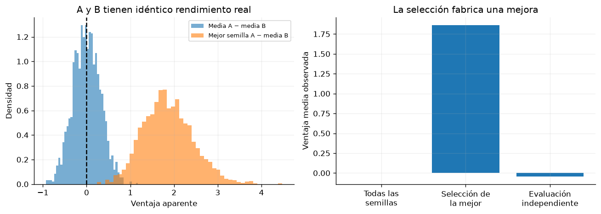

# Capítulo 8 · Agradecimientos y práctica de cierre

**Lectura:** p. 199. [Apartado original](https://arxiv.org/html/2412.05265v5#Ch8).

## Resumen fiel al apartado

Este capítulo reconoce la procedencia de parte del material de los capítulos 34 y 35 de *Probabilistic Machine Learning: Advanced Topics*, incluyendo trabajo escrito con Lihong Li. Murphy indica que esta monografía amplía y sustituye aquel tratamiento. También agradece comentarios de colegas y ayuda con figuras.

No introduce algoritmos ni resultados técnicos. La bibliografía que sigue tampoco es un capítulo de métodos. Para acompañar todos los capítulos numerados sin inventar contenido, añadimos una práctica metodológica propia, conectada con §1.3.7.

## Experimento 8 · Elegir la mejor semilla fabrica una mejora

**Pregunta:** ¿qué sucede si comparamos la mejor ejecución de un algoritmo con el promedio de otro?

Simulamos 2.000 estudios. En cada uno, A y B tienen exactamente la misma distribución real de rendimiento, normal de media 0 y desviación 1, y disponemos de 20 semillas de cada algoritmo.

Comparamos tres formas de informar: media de A menos media de B; máximo de A menos media de B; y una nueva evaluación independiente del resultado seleccionado. En este modelo toda semilla comparte calidad real, así que seleccionar solo el ruido positivo no crea una mejora real.

~~~bash
uv run python -m experimentos.ejecutar --capitulo 8
~~~

**Hipótesis:** comparar todas las semillas produce una diferencia cercana a cero. Seleccionar la mejor de A produce una ventaja positiva ficticia.

**Métrica:** distribución de la ventaja observada en los estudios. El resultado guardado muestra aproximadamente 0.001 al comparar medias, 1.864 al seleccionar la mejor semilla y −0.044 en la evaluación independiente. Son fluctuaciones de la simulación alrededor de las expectativas correspondientes.

**Modificación:** cambia 20 semillas a 5 y a 100. Cuantas más oportunidades de seleccionar un extremo, mayor puede ser el optimismo introducido por esa selección.

**Límite:** aquí las diferencias entre semillas son puro ruido, por construcción. En una tarea real puede existir calidad persistente entre políticas; la evaluación independiente sigue siendo necesaria para distinguirla del ruido de selección.

## Para cerrar el grupo

Lleva una pequeña ficha con el entorno, la recompensa, la política, el presupuesto de interacción y cómputo, las semillas y las métricas. Añade una afirmación respaldada por tus datos y otra que tus datos no permiten sostener. Cita al autor del libro y distingue los experimentos de esta guía de las figuras o resultados originales.
